# WARLINK // ПОЛНАЯ АРХИТЕКТУРНАЯ КАРТА ДАННЫХ И СВЯЗЕЙ СЕРВЕР-КЛИЕНТ-БД

Документ предназначен для мгновенной навигации разработчиков и ИИ-агентов. Содержит полный аудит динамических серверных данных, жестко зашитых клиентских параметров и сквозную матрицу связей интерфейса с базой данных PostgreSQL, Redis, VictoriaMetrics и Directus CMS.

---

## 1. СРАВНИТЕЛЬНЫЙ АУДИТ: СЕРВЕР VS КЛИЕНТСКИЙ ХАРДКОД

### 1.1. Сборы, цели и финансы (Community Goals & Donates)
| Сущность | Источник истины на сервере | Динамическая отдача API | Жестко зашито в клиенте | Риск рассинхронизации |
| :--- | :--- | :--- | :--- | :--- |
| **Цель сбора на инфраструктуру (Аренда серверов)** | `cluster_nodes` (даты оплаты `paid_until`, стоимость Aeza), кэш в RAM (`cachedRealDue`) | `GET /api/v1/community/goal` -> `infrastructure`: целевая сумма (1690 руб / 13 EUR), текущий баланс, оплаченные дни | В `ui/views/donate-modal.html` и `main.go`: дефолтные тексты "Оплачено на 18 дн.", 100 руб/30 дней | Низкий (при успешном ответе перетирается данными сервера) |
| **Спецпроект Battlefield 6 (Цель, базовая цена, скидка)** | Таблица `server_settings` (`bf6_goal_target`, `bf6_goal_current`, `bf6_goal_completed`) и `server_config` | `GET /api/v1/community/goal` -> `special_projects[0]` (`target_amount_rub`, `base_price_rub`, `discount_price_rub`) | 1. `ui/views/donate-modal.html`: захардкожено `3 200 руб` и шкала `0 / 3 200 руб`. 2. `ui/js/account.js`: fallback target 3200 руб. 3. `main.go`: fallback 3200 руб, discount 0 руб. | **КРИТИЧЕСКИЙ (P0):** Если на сервере в `server_settings` стоит 4100 руб, а в UI зашит 3200 руб, то при сбое сети или до гидратации пользователь видит старую/неверную цену. При смене скидок в Steam требуется правка и в БД, и в HTML |
| **Основная цель автора (Boosty Goal)** | Таблица `server_settings` (`boosty_goal_title`, `boosty_goal_target`, `boosty_goal_current`, `boosty_goal_source`) | `GET /api/v1/boosty-goal`, `GET /api/v1/community/goal` -> `author_boosty` | В `ui/views/donate-modal.html` захардкожен дефолтный тайтл "WarLink \| Поддержка дальнейшей разработки \| Долги" и 100 000 руб | Низкий (обновляется через SWR кэш) |
| **Донат через СБП / Карты (Aeza Invoice)** | Таблица `pending_donations`, интеграция с Aeza API по ключу `WARLINK_AEZA_API_KEY` | `POST /api/v1/donate` -> генерация платежной ссылки Yookassa/Aeza | В `main.go`: минимальная сумма 100 руб. В `ui/views/donate-modal.html`: фиксированные перки "100 руб = 30 дней", метод "sbp" | Средний |
| **USDT TRC20 криптокошелек** | Не хранится в БД (статический) | Сервер не отдает динамический крипто-адрес | В `ui/views/donate-modal.html` жестко зашит адрес: `TE1hrh5yy7hnHpCX7fz51rPvWubpcJJgaM` | **ВЫСОКИЙ (P1):** Смена адреса кошелька требует перекомпиляции и апдейта клиента |
| **Ссылки на донат** | `server/main.go` константы Boosty URL | `GET /api/v1/community/goal` | В `ui/views/donate-modal.html` и `ui/views/sponsors-view.html` жестко зашиты ссылки: `https://boosty.to/pld1n/...` и Steam `https://steamcommunity.com/id/MaksimPaladin/` | Средний |

---

### 1.2. Сетевая инфраструктура и маршрутизация (Network & Routing)
| Сущность | Источник истины на сервере | Динамическая отдача API | Жестко зашито в клиенте | Риск рассинхронизации |
| :--- | :--- | :--- | :--- | :--- |
| **Адреса серверов и шлюзов** | DNS-записи домена `*.warlink.max-alekseyev.com`: `api-warlink` (138.124.103.99), `de.warlink` (85.192.24.254), `ru.warlink` (45.12.63.85) | `GET /api/v1/status`, `GET /api/v1/community/goal` (список нод `cluster_nodes`) | 1. `internal/singbox/singbox.go`: константы `MoscowIngressDomain`, `FrankfurtEdgeDomain`, `StockholmCoreDomain`, а также IP `45.12.63.85`, `85.192.24.254`, `138.124.103.99`. 2. `warlink_core/config.json`: `server_ip = 138.124.103.99` | **ВЫСОКИЙ (P1):** При переносе сервера на новый IP/провайдер клиент без DNS-резолвинга или старых версий потеряет связь |
| **Порты туннелей Hysteria 2** | Конфиги `/etc/hysteria/config.yaml` на нодах (Франкфурт: UDP 443; Москва: UDP 8443 и 443) | Нет отдельного эндпоинта портов | В `internal/singbox/singbox.go` жестко зашиты порты: Франкфурт: 443; Москва Transit: 443; Москва Direct: 8443 | **ВЫСОКИЙ (P1):** Смена рабочего порта Hysteria требует клиентского патча |
| **Правила фильтрации и ACL (IP, Домены, Процессы)** | `server/aclgen/singbox_gen.go` и `server/main.go` (`/api/v1/singbox/config`, `/api/v1/profiles`) | `GET /api/v1/singbox/config` генерирует полный JSON для клиента на лету | В `internal/singbox/singbox.go` зашиты аварийные списки: `BlockedServiceDomains` (120+ доменов), `BlockedServiceIPs` (CIDR Telegram/Instagram), AION 2 подсети (NCSoft Korea 216.107.254.0/24, Arelion Sweden 80.239.138.0/24, STUN 212.101.4.0/24) | Низкий: Клиент сначала запрашивает конфиг с сервера, локальный хардкод активируется только при офлайне |
| **Игровые процессы WARDOGS / EAC** | Таблица `supported_games` (частично) | `GET /api/v1/games/catalog` | В `warlink_core/config.json` и `main.go`: `WardogsClient-Win64-Shipping.exe`, `WardogsLauncher-Shipping.exe`, `Elytra-Setup.exe`, `PioneerGame.exe`, `AION2.exe` | Средний |
| **Секреты HMAC и Obfs** | Переменные окружения `WARLINK_HMAC_SECRET`, `WARLINK_OBFS_PASSWORD` на сервере | Не передаются в API | В `warlink_core/config.json` и внедряются через `-ldflags` при сборке | Критично: При компрометации секрета требуется перевыпуск сервера и клиента |

---

### 1.3. Аккаунты, Спонсоры и Привилегии
| Сущность | Источник истины на сервере | Динамическая отдача API | Жестко зашито в клиенте | Риск рассинхронизации |
| :--- | :--- | :--- | :--- | :--- |
| **Профиль пользователя (Ник, Аватар, Тир, Спонсорство)** | Таблица `accounts` (`account_number`, `nickname`, `avatar_url`, `tier`, `sponsor_until`, `total_donated_rub`, `steam_id`, `motto`, `hide_donation_amount`, `discord_id`) | `GET /api/v1/profile?account_number=...` | В `warlink_core/config.json`: локальная копия профиля. При старте синхронизируется с сервером | Минимальный |
| **Привязка устройств к аккаунту** | Таблица `account_devices` (`account_number`, `device_id`, `created_at`) | `GET /api/v1/profile` возвращает список привязанных устройств | Локально хранится только текущий `device_id` (генерируется из `MachineGUID`) | Отсутствует |
| **Тиры спонсоров и привилегии** | Таблица `accounts` + логика в `server/main.go` | `GET /api/v1/sponsors/tiers`, `GET /api/v1/sponsors` | В `ui/views/sponsors-view.html` захардкожены базовые карточки спонсоров | Минимальный |
| **Связка с Discord** | Таблица `accounts` (`discord_id`, `discord_tag`) + Redis `wl:discord:code:*` (TTL 10 мин) | `POST /api/v1/profile/discord/link-code` | Клиент только запрашивает и отображает 6-значный код | Отсутствует |

---

### 1.4. Игровой рынок золота (Gold Market)
| Сущность | Источник истины на сервере | Динамическая отдача API | Жестко зашито в клиенте | Риск рассинхронизации |
| :--- | :--- | :--- | :--- | :--- |
| **Цены и история золота WARDOGS** | Воркер `startGoldMarketWorker` раз в 15 минут опрашивает MetaForge API. Кэширует в таблицу `gold_market_cache` | `GET /api/v1/market/gold` (отдает `current_price`, `min_price`, `max_price`, `change_7d`, `change_30d`, `history_json`) | В `main.go` зашит прямой резервный URL: `https://metaforge.app/api/wardogs/market` на случай падения мастера | Отсутствует (двойное резервирование) |

---

### 1.5. Каталог игр и голосование сообщества (Voting & Games)
| Сущность | Источник истины на сервере | Динамическая отдача API | Жестко зашито в клиенте | Риск рассинхронизации |
| :--- | :--- | :--- | :--- | :--- |
| **Поддерживаемые игры** | Таблица `supported_games` (`steam_app_id`, `title`, `slug`, `icon_url`) | `GET /api/v1/games/catalog` | В `warlink_core/config.json` зашиты 4 базовые игры (WARDOGS 1867240, ARC Raiders 1808500, Dark and Darker 2016590, AION 2 3393110) | Низкий |
| **Голосование за добавление игр** | Таблицы `game_suggestions`, `device_votes`, `forbidden_steam_games` | `GET /api/v1/votes`, `POST /api/v1/votes` | В клиенте логика отправки голоса, валидация Steam App ID | Отсутствует |

---

### 1.6. База данных прокачки и предметов (Progression DB)
| Сущность | Источник истины на сервере | Динамическая отдача API | Жестко зашито в клиенте | Риск рассинхронизации |
| :--- | :--- | :--- | :--- | :--- |
| **Справочник предметов (233 награды прокачки)** | Сервер хранит файл `internal/progression/progression_db.json` и отдает через `GET /api/v1/progression/database` | `GET /api/v1/progression/database` | Файл `internal/progression/progression_db.json` физически скомпилирован в бинарник клиента через `//go:embed` | Средний: Новые предметы WARDOGS требуют обновления JSON на сервере, клиент скачивает его при старте |
| **Прогресс конкретного игрока** | Колонка `accounts.progression` (JSONB) | `GET /api/v1/profile` | В `warlink_core/config.json` поле `progression` (роли, уровни, вишлист) | Отсутствует (двусторонняя синхронизация) |

---

### 1.7. Фиче-флаги (Feature Flags)
| Сущность | Источник истины на сервере | Динамическая отдача API | Жестко зашито в клиенте | Риск рассинхронизации |
| :--- | :--- | :--- | :--- | :--- |
| **Флаги функционала** | Таблица `feature_flags` (`name`, `enabled`, `rollout_pct`, `strategy`, `target_accounts`, `min_version`, `payload`) | `GET /api/v1/features`, `GET /api/v1/client/features`, SSE `flags:updated` | В `internal/features/` зашиты дефолтные значения (fallback) | Отсутствует (полная динамика) |

---

### 1.8. Техподдержка и баг-репорты (Support & Tickets)
| Сущность | Источник истины на сервере | Динамическая отдача API | Жестко зашито в клиенте | Риск рассинхронизации |
| :--- | :--- | :--- | :--- | :--- |
| **Тикеты и диалоги** | Таблицы `support_tickets`, `ticket_messages`, `ticket_canned_responses` | `POST /api/v1/tickets`, `GET /api/v1/tickets/active`, `POST /api/v1/tickets/messages`, `POST /api/v1/tickets/logs` | Клиент лишь упаковывает локальные логи в ZIP и отправляет Base64/Binary | Отсутствует |

---

### 1.9. Уведомления и депеши (In-App Notifications)
| Сущность | Источник истины на сервере | Динамическая отдача API | Жестко зашито в клиенте | Риск рассинхронизации |
| :--- | :--- | :--- | :--- | :--- |
| **Депеши администратора** | Таблицы `in_app_notifications`, `notification_reads`, Redis канал `notifications:new` | `GET /api/v1/notifications`, `POST /api/v1/notifications/read`, SSE `/api/v1/events` | Клиент только рендерит карточки депеш в `#view-notifications` | Отсутствует |

---

### 1.10. Телеметрия и мониторинг качества (Telemetry & Health)
| Сущность | Источник истины на сервере | Динамическая отдача API | Жестко зашито в клиенте | Риск рассинхронизации |
| :--- | :--- | :--- | :--- | :--- |
| **Автоматическая сетевая телеметрия** | Таблица `routing_telemetry_auto`, метрики VictoriaMetrics (`warlink_client_ping_ms`, `warlink_client_loss_ratio`, `warlink_client_jitter_ms`) | `POST /api/v1/telemetry/beacon` | Клиентский фоновый воркер (`beacon.go`) с интервалом замеров 60-120 сек | Отсутствует |
| **Краш-дампы** | Таблица `crash_reports` | `POST /api/v1/telemetry/crash` | Клиентский обработчик ошибок | Отсутствует |

---

## 2. ПОЛНАЯ КАРТА СВЯЗЕЙ ПРИЛОЖЕНИЯ В БАЗУ ДАННЫХ (AI NAVIGATION GRAPH)

```mermaid
flowchart TD
    subgraph UI_Client ["Клиентское приложение WarLink (Win32 / WebView2)"]
        UI_Home["Главный экран (#view-main)"]
        UI_Donate["Модальное окно доната (#modal-donate-custom)"]
        UI_Market["Вкладка Золотообмен (#view-details)"]
        UI_Sponsors["Вкладка Спонсоры (#view-sponsors)"]
        UI_Account["Вкладка Аккаунт (#view-account)"]
        UI_Notif["Вкладка Депеши (#view-notifications)"]
        UI_Progression["Вкладка Прокачка (#view-progression)"]
        UI_Support["Техподдержка (#modal-ticket)"]
        UI_Beacon["Фоновый воркер телеметрии (beacon.go)"]
    end

    subgraph Client_Backend ["Локальный Go-сервер клиента (localhost:127.0.0.1)"]
        L_Connect["/api/connect"]
        L_Goal["/api/community-goal"]
        L_Donate["/api/server-donate"]
        L_Market["/api/market/gold"]
        L_Sponsors["/api/sponsors"]
        L_Profile["/api/user-profile"]
        L_Notif["/api/notifications"]
        L_Prog["/api/progression"]
        L_Support["/api/support/*"]
    end

    subgraph Master_Server ["Центральный сервер API (138.124.103.99:8081)"]
        S_Session["/api/v1/session (HMAC)"]
        S_Goal["/api/v1/community/goal"]
        S_Donate["/api/v1/donate"]
        S_Market["/api/v1/market/gold"]
        S_Sponsors["/api/v1/sponsors"]
        S_Profile["/api/v1/profile"]
        S_Notif["/api/v1/notifications"]
        S_Prog["/api/v1/progression/database"]
        S_Tickets["/api/v1/tickets/*"]
        S_Beacon["/api/v1/telemetry/beacon"]
        S_Admin["/api/v1/admin/*"]
    end

    subgraph Persistence ["Слой персистентности и баз данных (Stockholm VPS)"]
        subgraph Postgres ["PostgreSQL (warlink_db)"]
            T_Accounts[("accounts")]
            T_AccDevices[("account_devices")]
            T_Nodes[("cluster_nodes")]
            T_Settings[("server_settings")]
            T_Config[("server_config")]
            T_Gold[("gold_market_cache")]
            T_Notifs[("in_app_notifications")]
            T_NotifReads[("notification_reads")]
            T_Tickets[("support_tickets")]
            T_TicketMsg[("ticket_messages")]
            T_AutoTelem[("routing_telemetry_auto")]
            T_ConnHist[("user_connection_history")]
            T_Games[("supported_games")]
            T_Votes[("device_votes")]
            T_Flags[("feature_flags")]
            T_Bans[("security_bans")]
            T_Crashes[("crash_reports")]
        end

        subgraph Redis_Cache ["Redis (6379)"]
            R_Sess["wl:sess:TOKEN (TTL)"]
            R_Dev["wl:dev:DEVICE_ID (TTL)"]
            R_Discord["wl:discord:code:CODE"]
            R_PubSub["PubSub: tickets / notifications / flags"]
        end

        subgraph Metrics_DB ["VictoriaMetrics (8428) + Grafana (3000)"]
            VM_Metrics["warlink_* (сессии, пинг, дропы, нагрузка)"]
        end
    end

    %% UI to Local Client
    UI_Home --> L_Connect
    UI_Donate --> L_Goal
    UI_Donate --> L_Donate
    UI_Market --> L_Market
    UI_Sponsors --> L_Sponsors
    UI_Account --> L_Profile
    UI_Notif --> L_Notif
    UI_Progression --> L_Prog
    UI_Support --> L_Support
    UI_Beacon --> S_Beacon

    %% Local Client to Master Server
    L_Connect --> S_Session
    L_Goal --> S_Goal
    L_Donate --> S_Donate
    L_Market --> S_Market
    L_Sponsors --> S_Sponsors
    L_Profile --> S_Profile
    L_Notif --> S_Notif
    L_Prog --> S_Prog
    L_Support --> S_Tickets

    %% Master Server to PostgreSQL
    S_Session --> T_Accounts
    S_Session --> T_ConnHist
    S_Session --> R_Sess
    S_Session --> R_Dev
    S_Goal --> T_Nodes
    S_Goal --> T_Settings
    S_Goal --> T_Config
    S_Donate --> T_Accounts
    S_Market --> T_Gold
    S_Sponsors --> T_Accounts
    S_Profile --> T_Accounts
    S_Profile --> T_AccDevices
    S_Notif --> T_Notifs
    S_Notif --> T_NotifReads
    S_Tickets --> T_Tickets
    S_Tickets --> T_TicketMsg
    S_Tickets --> R_PubSub
    S_Beacon --> T_AutoTelem
    S_Beacon --> VM_Metrics
    S_Admin --> T_Settings
    S_Admin --> T_Flags
    S_Admin --> T_Bans
```

---

## 3. CHEAT SHEET ДЛЯ ИИ-АГЕНТА: БЫСТРЫЙ ПОИСК И МОДИФИКАЦИЯ

Когда необходимо изменить сущность или диагностировать сбой, использовать следующую таблицу:

| Задача / Что нужно изменить | Клиентский файл (UI / Go) | Локальный роут | Серверный роут в `server/main.go` | Таблица БД / Хранилище | SQL / Команда быстрого обновления |
| :--- | :--- | :--- | :--- | :--- | :--- |
| **Изменить цену / цель Battlefield 6** | `ui/views/donate-modal.html`, `ui/js/account.js`, `main.go` | `/api/community-goal` | `handleCommunityGoals` (стр. 9100+) | Таблица `server_settings` (ключи `bf6_goal_target`, `bf6_goal_current`) | `UPDATE server_settings SET value = '3200' WHERE key = 'bf6_goal_target';` |
| **Изменить цель сбора Boosty** | `ui/views/donate-modal.html` | `/api/community-goal` | `handleGetBoostyGoal`, `handleAdminBoostyGoal` | Таблица `server_settings` (`boosty_goal_target`, `boosty_goal_title`) | `UPDATE server_settings SET value = '150000' WHERE key = 'boosty_goal_target';` |
| **Срок аренды / Ноды серверов** | `ui/views/donate-modal.html` | `/api/community-goal` | `handleCommunityGoals` (опрос Aeza API) | Таблица `cluster_nodes` (`paid_until`, `status`) | `UPDATE cluster_nodes SET paid_until = '2026-11-20' WHERE node_id = 'decisive-amber';` |
| **Выдать игроку статус Спонсора** | `ui/views/account-view.html` | `/api/user-profile` | `handleProfile` | Таблица `accounts` (`tier`, `sponsor_until`) | `UPDATE accounts SET tier = 'sponsor', sponsor_until = NOW() + INTERVAL '30 days' WHERE account_number = 'XXXX-XXXX-XXXX-XXXX';` |
| **Разблокировать / Сбросить привязку ПК** | `ui/views/account-view.html` | `/api/user-profile/reset-devices` | `handleProfileResetDevices` | Таблица `account_devices` | `DELETE FROM account_devices WHERE account_number = 'XXXX-XXXX-XXXX-XXXX';` |
| **Добавить / Заблокировать игру в голосовании** | `ui/views/showcase-view.html` | `/api/votes` | `handleVotes` | Таблицы `supported_games`, `forbidden_steam_games` | `INSERT INTO forbidden_steam_games (steam_app_id, title, reason, blocked_by) VALUES (12345, 'Название', 'Причина', 'admin');` |
| **Отправить срочную депешу всем игрокам** | `ui/views/notifications-view.html` | `/api/notifications` | `POST /api/v1/admin/notifications` | Таблица `in_app_notifications` + Redis `notifications:new` | `curl -X POST http://127.0.0.1:8081/api/v1/admin/notifications -H "Content-Type: application/json" -d '{"title":"Внимание","message":"Текст","severity":"urgent","target_type":"broadcast"}'` |
| **Управление фиче-флагами (A/B тесты)** | `internal/features/` | `/api/features` | `handleAdminFeatureFlags` | Таблица `feature_flags` | `UPDATE feature_flags SET enabled = true, rollout_pct = 100 WHERE name = 'new_engine';` |
| **Изменить лимит слотов / Drain mode** | Главный экран статуса | `/api/status` | `handleAdminSettings` | Таблица `server_settings` (`max_sessions`, `drain_mode`) | `UPDATE server_settings SET value = '200' WHERE key = 'max_sessions'; UPDATE server_settings SET value = 'true' WHERE key = 'drain_mode';` |
| **Забанить читера / нарушителя** | Главный экран статуса | `/api/connect` | `handleSession` (проверка `security_bans`) | Таблица `security_bans` | `INSERT INTO security_bans (target_type, target_value, reason, banned_by) VALUES ('account', '5230-6527-2989-4096', 'Абуз', 'admin');` |
| **Посмотреть тикеты игроков** | `ui/views/support-modal.html` | `/api/support/*` | `handleClientTicketSubmit`, `handleAdminTicketsList` | Таблицы `support_tickets`, `ticket_messages` | `SELECT id, account_number, category, status, created_at FROM support_tickets ORDER BY id DESC LIMIT 10;` |

---

## 4. АРХИТЕКТУРНЫЕ ВЫВОДЫ И ПЛАН УСТРАНЕНИЯ ХАРДКОДА

### Проблема, выявленная во время аудита (Инцидент со скидкой 3200 / 4100):
1. **Причина инцидента:** Значение цены игры Battlefield 6 присутствовало сразу в четырех независимых слоях:
   - В PostgreSQL в таблице `server_settings` (`bf6_goal_target = 4100`).
   - В `server/main.go` в дефолтной переменной (`bf6Target = 3200`).
   - В клиентском `main.go` в резервном JSON (`target_amount_rub: 3200`).
   - В HTML-разметке `ui/views/donate-modal.html` в теге `3 200 руб`.
2. Когда закончилась осенняя распродажа в Steam, смена значения только в одном месте приводила либо к визуальному миганию при загрузке, либо к показу старой цены при задержке ответа сервера.
3. **Решение для архитектуры WarLink:**
   - **Единый динамический контракт:** Все числовые цели, цены, адреса криптокошельков и списки шлюзов должны гидрироваться ИСКЛЮЧИТЕЛЬНО из ответа мастер-API.
   - В HTML и JS разметке в исходном коде должны находиться скелетоны загрузки (индикаторы ожидания данных), а не статические цифры.
   - Любое изменение цен и акций должно производиться строго одной SQL-командой или через панель Directus CMS без необходимости выпуска клиентских релизов и перекомпиляции `WarLink.exe`.
